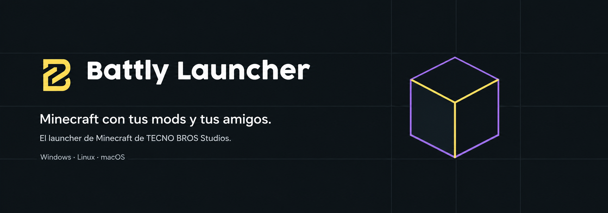

Battly es un launcher de Minecraft Java Edition para Windows, Linux y macOS, desarrollado por TECNO BROS Studios. Desde él puedes preparar tus versiones de Minecraft, instalar mods, organizar instancias y jugar con tus amigos.

**[Descargar Battly](https://battlylauncher.com/download)** · [Web oficial](https://battlylauncher.com) · [Informar de un problema](https://github.com/BattlyLauncher/battlylauncher/issues)

## Jugar con Battly

Descarga el instalador de tu sistema desde la web oficial e inicia sesión con tu cuenta de Battly o Microsoft. Después puedes elegir una versión de Minecraft o crear una instancia para un modpack. Las instancias mantienen separados sus mods, ajustes y mundos, así que puedes probar otra configuración sin tocar la que ya usas.

El launcher incluye:

- **Versiones y loaders.** Instala Minecraft con Fabric, Forge, NeoForge, Quilt, LegacyFabric u OptiFine, según la versión que elijas.
- **Mods y modpacks.** Busca contenido, instálalo en una instancia y gestiona sus archivos. La cesta de mods, todavía en beta, permite reunir varios mods y comprobar sus versiones y dependencias antes de instalarlos.
- **Battly Worlds.** Comparte tu mundo con amigos, entra mediante un código o acepta una invitación desde Battly.
- **Battly Servers.** Crea y administra servidores de Minecraft desde el launcher.
- **Battly Music.** Busca música, guarda favoritos y organiza tus playlists mientras juegas.
- **Ajustes y reparaciones.** Elige Java, configura la memoria y consulta los registros. Cuando Battly reconoce un problema, puede proponer una reparación.

Los canales estable y beta se eligen en Ajustes. Battly comprueba las actualizaciones automáticamente; la beta permite probar cambios antes de que lleguen al canal estable.

## Ayuda y sugerencias

Si algo falla, abre una [incidencia](https://github.com/BattlyLauncher/battlylauncher/issues) con tu sistema operativo, la versión de Battly y los pasos para reproducirlo. Si el problema ocurre al abrir Minecraft, indica también la versión del juego, el loader y los mods que utilizas. Los registros que guarda Battly ayudan a encontrar la causa.

También puedes encontrar el acceso a la comunidad y al soporte en [battlylauncher.com](https://battlylauncher.com).

## Código y desarrollo

Este repositorio contiene la aplicación de escritorio, escrita en TypeScript sobre Electron. Las APIs de Battly y Battly Music se mantienen por separado. Para preparar el entorno necesitas Git, Node.js 22.13.0 o posterior y npm:

```sh
npm ci
npm run dev
```

`npm run dev` compila y abre Battly. `npm start` abre la compilación que ya tengas en `dist/`. La aplicación puede conectarse a los servicios de Battly y leer datos guardados, así que usa un perfil separado si vas a probar migraciones o reparaciones.

Las ventanas y los servicios están en [src/main](src/main), la interfaz en [src/renderer](src/renderer) y la comunicación entre ambos en [src/preload](src/preload). La entrada de la aplicación está en [bootstrap](bootstrap).

Para comprobar tipos, lint y formato, ejecuta `npm run check`. `npm run build` genera la compilación. Los comandos `npm run build:win:release`, `npm run build:linux:release` y `npm run build:mac:release` preparan los paquetes de cada plataforma; requieren sus herramientas de compilación y no publican una release.

## Licencia

Battly es un proyecto de **código público con licencia personalizada de TECNO BROS Studios**. No es software de código abierto y no se distribuye bajo MIT, GPL ni otras licencias de código abierto. Que puedas consultar el código no concede permiso para modificarlo, redistribuirlo o crear productos derivados fuera de lo que permita su [licencia](LICENSE.MD).

Las dependencias y los componentes de terceros conservan sus propias licencias y avisos. La marca, el logo y los recursos de Battly pertenecen a sus respectivos titulares.

Battly es un proyecto independiente y no está afiliado a Mojang ni a Microsoft.
